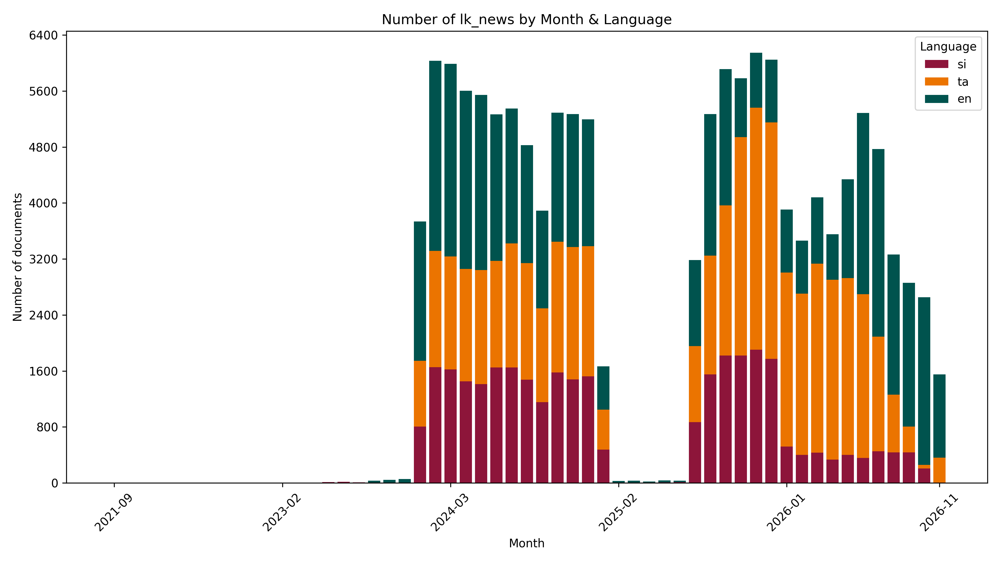

# 📄#SriLanka 🇱🇰 News `Dataset`


[https://github.com/nuuuwan/lk_news/tree/data/data/lk_news](https://github.com/nuuuwan/lk_news/tree/data/data/lk_news)

A collection of lk_news documents.

- [**135,865** documents](https://github.com/nuuuwan/lk_news/tree/data/data/lk_news) (**2.1 GB**), from **2021-09-12** to **2026-11-16**, scraped from [https://www.virakesari.lk](https://www.virakesari.lk), [https://www.tamilmirror.lk](https://www.tamilmirror.lk), [https://www.dailymirror.lk](https://www.dailymirror.lk), [http://sinhala.adaderana.lk](http://sinhala.adaderana.lk), [https://www.ada.lk](https://www.ada.lk), [https://www.ft.lk](https://www.ft.lk), [https://www.adaderana.lk](https://www.adaderana.lk), [http://island.lk](http://island.lk), [https://economynext.com](https://economynext.com), [https://www.lankadeepa.lk](https://www.lankadeepa.lk), [https://www.colombotelegraph.com](https://www.colombotelegraph.com), [https://www.bbc.com](https://www.bbc.com), [https://dbsjeyaraj.com](https://dbsjeyaraj.com), [https://www.newsfirst.lk](https://www.newsfirst.lk), [https://english.newsfirst.lk](https://english.newsfirst.lk) & [https://island.lk](https://island.lk)

- In **JSON**, **TXT** & **🤗 Hugging Face**

- In **සිංහල**, **தமிழ்** & **English**

- 🎓 Cite as **[arXiv:2510.04124](https://arxiv.org/abs/2510.04124) [cs.CL]**

## 📝 Example Metadata

```json
{
    "doc_type": "lk_news",
    "doc_id": "2026-11-16-dailymirrorlk-2e329b94",
    "num": "dailymirrorlk-2e329b94",
    "date_str": "2026-11-16",
    "description": "Market momentum cools as ASPI tests 22,000",
    "url_metadata": "https://www.dailymirror.lk/breaking-news/Market-momentum-cools-as-ASPI-tests-22-000/108-355019",
    "lang": "en",
    "newspaper_id": "dailymirrorlk",
    "time_ut": 1794836784.0
}
```



## 🤗 Hugging Face Datasets


- [nuuuwan/lk-news-docs](https://huggingface.co/datasets/nuuuwan/lk-news-docs)
- [nuuuwan/lk-news-chunks](https://huggingface.co/datasets/nuuuwan/lk-news-chunks)

## 🆕 20 Latest documents

- 2026-11-16 | `dailymirrorlk-2e329b94` | Market momentum cools as ASPI tests 22,000 | [data](https://github.com/nuuuwan/lk_news/tree/data/data/lk_news/2020s/2026/2026-11-16-dailymirrorlk-2e329b94)
- 2026-11-16 | `dailymirrorlk-094dff2f` | Namal questions timing of trade union leader’s arrest | [data](https://github.com/nuuuwan/lk_news/tree/data/data/lk_news/2020s/2026/2026-11-16-dailymirrorlk-094dff2f)
- 2026-11-16 | `dailymirrorlk-ff0fb621` | FBI team to visit Sri Lanka to assist probe into online scam centers | [data](https://github.com/nuuuwan/lk_news/tree/data/data/lk_news/2020s/2026/2026-11-16-dailymirrorlk-ff0fb621)
- 2026-11-16 | `dailymirrorlk-e6657ed3` | Budget 2027 fails to address people’s nutritional needs: Harsha | [data](https://github.com/nuuuwan/lk_news/tree/data/data/lk_news/2020s/2026/2026-11-16-dailymirrorlk-e6657ed3)
- 2026-11-16 | `dailymirrorlk-84d3cd43` | Parliamentary Committee mulls GPS, satellite collar to curb human-elephant conflict | [data](https://github.com/nuuuwan/lk_news/tree/data/data/lk_news/2020s/2026/2026-11-16-dailymirrorlk-84d3cd43)
- 2026-11-16 | `dailymirrorlk-3a26a11b` | President directs Met Department to assess social impact of extreme weather conditions | [data](https://github.com/nuuuwan/lk_news/tree/data/data/lk_news/2020s/2026/2026-11-16-dailymirrorlk-3a26a11b)
- 2026-11-16 | `dailymirrorlk-ec54e0a7` | Child singer among four injured in Hatton road accident | [data](https://github.com/nuuuwan/lk_news/tree/data/data/lk_news/2020s/2026/2026-11-16-dailymirrorlk-ec54e0a7)
- 2026-11-16 | `dailymirrorlk-b8783c98` | Ananda Palitha arrested over CPC overtime payment fraud | [data](https://github.com/nuuuwan/lk_news/tree/data/data/lk_news/2020s/2026/2026-11-16-dailymirrorlk-b8783c98)
- 2026-11-16 | `dailymirrorlk-f4c62c8c` | Strict action against bribery and corruption, regardless of status: MP Asoka Ranwala | [data](https://github.com/nuuuwan/lk_news/tree/data/data/lk_news/2020s/2026/2026-11-16-dailymirrorlk-f4c62c8c)
- 2026-11-16 | `virakesarilk-742a1b9d` | இருதரப்பு ஒத்துழைப்பு, நீல - பசுமைப் பொருளாதார வாய்ப்புகள் குறித்து எதிர்க்கட்சித் தலைவர் சஜித் பிரேமதாசவும் சீனத் தூதுவரும் விசேட சந்திப்பு | [data](https://github.com/nuuuwan/lk_news/tree/data/data/lk_news/2020s/2026/2026-11-16-virakesarilk-742a1b9d)
- 2026-11-16 | `virakesarilk-f04b284f` | துப்பாக்கி, தோட்டாக்களுடன் சந்தேகநபர் ஒருவர் கைது | [data](https://github.com/nuuuwan/lk_news/tree/data/data/lk_news/2020s/2026/2026-11-16-virakesarilk-f04b284f)
- 2026-11-16 | `virakesarilk-6c24e4ad` | ஆதவ் அர்ஜுனாவைப் பிரிவதாக அவரது மனைவி டெய்சி மார்ட்டின் அறிவிப்பு! | [data](https://github.com/nuuuwan/lk_news/tree/data/data/lk_news/2020s/2026/2026-11-16-virakesarilk-6c24e4ad)
- 2026-11-16 | `dailymirrorlk-06a1ca42` | William and Kate play ‘gully’ cricket with Sachin Tendulkar to begin India trip | [data](https://github.com/nuuuwan/lk_news/tree/data/data/lk_news/2020s/2026/2026-11-16-dailymirrorlk-06a1ca42)
- 2026-11-16 | `virakesarilk-88393176` | அஜித் குமாருடன் இணைந்த கன்னட சுப்பர் ஸ்டார் சிவ ராஜ்குமார் | [data](https://github.com/nuuuwan/lk_news/tree/data/data/lk_news/2020s/2026/2026-11-16-virakesarilk-88393176)
- 2026-11-16 | `dailymirrorlk-3dbeb31e` | At least 11 killed in blaze on Thailand’s Phuket island | [data](https://github.com/nuuuwan/lk_news/tree/data/data/lk_news/2020s/2026/2026-11-16-dailymirrorlk-3dbeb31e)
- 2026-11-16 | `virakesarilk-b4cef960` | மாகாண சபைத்தேர்தலுக்கு தொடரும் முட்டுக்கட்டை | [data](https://github.com/nuuuwan/lk_news/tree/data/data/lk_news/2020s/2026/2026-11-16-virakesarilk-b4cef960)
- 2026-11-16 | `virakesarilk-a70840de` | இலங்கைப் பாராளுமன்ற பிரதி சபாநாயகருக்கும் கொரிய பாராளுமன்றத் தூதுக்குழுவினருக்கும் இடையில் விசேட சந்திப்பு | [data](https://github.com/nuuuwan/lk_news/tree/data/data/lk_news/2020s/2026/2026-11-16-virakesarilk-a70840de)
- 2026-11-16 | `virakesarilk-bc7f50c2` | இலங்கை ஆட்கடத்தல் வழக்கில் தலைமறைவாக இருந்த முக்கிய சந்தேகநபர் இந்தியாவில் கைது | [data](https://github.com/nuuuwan/lk_news/tree/data/data/lk_news/2020s/2026/2026-11-16-virakesarilk-bc7f50c2)
- 2026-11-16 | `dailymirrorlk-b0fa6e22` | Water leakage disrupts surgeries at Colombo National Hospital | [data](https://github.com/nuuuwan/lk_news/tree/data/data/lk_news/2020s/2026/2026-11-16-dailymirrorlk-b0fa6e22)
- 2026-11-16 | `virakesarilk-68665759` | 'மொத ராத்திரி' பட நடிகர் டி கே கார்த்திகேயன் கதையின் நாயகனாக அறிமுகமாகும் 'லவ் லாக்' படத்தின் தொடக்க விழா | [data](https://github.com/nuuuwan/lk_news/tree/data/data/lk_news/2020s/2026/2026-11-16-virakesarilk-68665759)

---

### [More Datasets about 🇱🇰 #SriLanka](https://github.com/nuuuwan/lk_datasets)


[](https://opensource.org/licenses/MIT)
