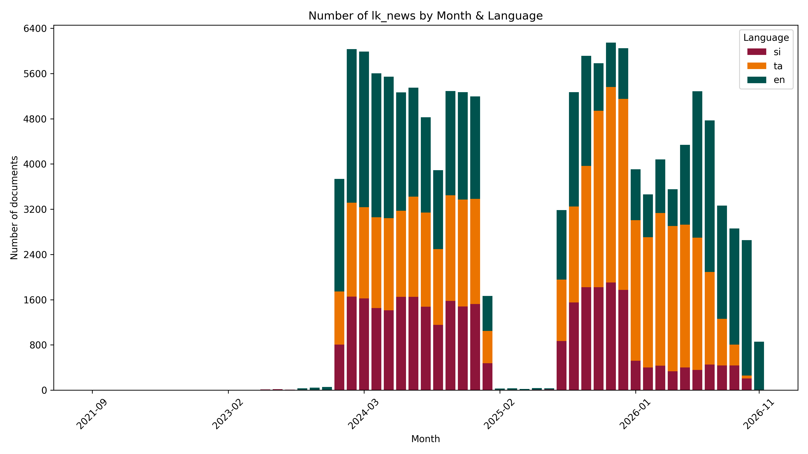

# 📄#SriLanka 🇱🇰 News `Dataset`


[https://github.com/nuuuwan/lk_news/tree/data/data/lk_news](https://github.com/nuuuwan/lk_news/tree/data/data/lk_news)

A collection of lk_news documents.

- [**135,038** documents](https://github.com/nuuuwan/lk_news/tree/data/data/lk_news) (**2.1 GB**), from **2021-09-12** to **2026-11-07**, scraped from [https://www.virakesari.lk](https://www.virakesari.lk), [https://www.tamilmirror.lk](https://www.tamilmirror.lk), [https://www.dailymirror.lk](https://www.dailymirror.lk), [http://sinhala.adaderana.lk](http://sinhala.adaderana.lk), [https://www.ada.lk](https://www.ada.lk), [https://www.ft.lk](https://www.ft.lk), [https://www.adaderana.lk](https://www.adaderana.lk), [http://island.lk](http://island.lk), [https://economynext.com](https://economynext.com), [https://www.lankadeepa.lk](https://www.lankadeepa.lk), [https://www.colombotelegraph.com](https://www.colombotelegraph.com), [https://www.bbc.com](https://www.bbc.com), [https://dbsjeyaraj.com](https://dbsjeyaraj.com), [https://www.newsfirst.lk](https://www.newsfirst.lk), [https://english.newsfirst.lk](https://english.newsfirst.lk) & [https://island.lk](https://island.lk)

- In **JSON**, **TXT** & **🤗 Hugging Face**

- In **සිංහල**, **தமிழ்** & **English**

- 🎓 Cite as **[arXiv:2510.04124](https://arxiv.org/abs/2510.04124) [cs.CL]**

## 📝 Example Metadata

```json
{
    "doc_type": "lk_news",
    "doc_id": "2026-11-07-dailymirrorlk-d063798c",
    "num": "dailymirrorlk-d063798c",
    "date_str": "2026-11-07",
    "description": "Does the Govt. have a say in judicial transfers? Justice Minister responds",
    "url_metadata": "https://www.dailymirror.lk/breaking-news/Does-the-Govt-have-a-say-in-judicial-transfers-Justice-Minister-responds/108-354419",
    "lang": "en",
    "newspaper_id": "dailymirrorlk",
    "time_ut": 1794063348.0
}
```



## 🤗 Hugging Face Datasets


- [nuuuwan/lk-news-docs](https://huggingface.co/datasets/nuuuwan/lk-news-docs)
- [nuuuwan/lk-news-chunks](https://huggingface.co/datasets/nuuuwan/lk-news-chunks)

## 🆕 20 Latest documents

- 2026-11-07 | `dailymirrorlk-d063798c` | Does the Govt. have a say in judicial transfers? Justice Minister responds | [data](https://github.com/nuuuwan/lk_news/tree/data/data/lk_news/2020s/2026/2026-11-07-dailymirrorlk-d063798c)
- 2026-11-07 | `dailymirrorlk-18341b9c` | Special task force to be established to respond to Colombo floods | [data](https://github.com/nuuuwan/lk_news/tree/data/data/lk_news/2020s/2026/2026-11-07-dailymirrorlk-18341b9c)
- 2026-11-07 | `dailymirrorlk-3568c6d4` | 129mm rainfall in one hour caused Colombo flash floods: CMC | [data](https://github.com/nuuuwan/lk_news/tree/data/data/lk_news/2020s/2026/2026-11-07-dailymirrorlk-3568c6d4)
- 2026-11-07 | `dailymirrorlk-d334366c` | After midterm rout, Vance tries to build his own 2028 brand | [data](https://github.com/nuuuwan/lk_news/tree/data/data/lk_news/2020s/2026/2026-11-07-dailymirrorlk-d334366c)
- 2026-11-07 | `dailymirrorlk-5a3f2cca` | Elon Musk appears to signal the end of the road for Cybertruck | [data](https://github.com/nuuuwan/lk_news/tree/data/data/lk_news/2020s/2026/2026-11-07-dailymirrorlk-5a3f2cca)
- 2026-11-07 | `dailymirrorlk-0fd1976a` | Deduru Oya residents alerted as 4,100 cusecs released | [data](https://github.com/nuuuwan/lk_news/tree/data/data/lk_news/2020s/2026/2026-11-07-dailymirrorlk-0fd1976a)
- 2026-11-07 | `dailymirrorlk-74e3f229` | UNP urges government to recommence WB aided Colombo City Flood Mitigation Project | [data](https://github.com/nuuuwan/lk_news/tree/data/data/lk_news/2020s/2026/2026-11-07-dailymirrorlk-74e3f229)
- 2026-11-07 | `dailymirrorlk-e303e507` | Govt. to consult public before proceeding with proposed anti-terrorism, organised crime Bills: President | [data](https://github.com/nuuuwan/lk_news/tree/data/data/lk_news/2020s/2026/2026-11-07-dailymirrorlk-e303e507)
- 2026-11-07 | `dailymirrorlk-15ded5e6` | Independent foreign team sought for post-mortem on tusker Kawanthissa’s death | [data](https://github.com/nuuuwan/lk_news/tree/data/data/lk_news/2020s/2026/2026-11-07-dailymirrorlk-15ded5e6)
- 2026-11-07 | `dailymirrorlk-ff197c09` | Prime Minister returns after CHOGM 2026 | [data](https://github.com/nuuuwan/lk_news/tree/data/data/lk_news/2020s/2026/2026-11-07-dailymirrorlk-ff197c09)
- 2026-11-07 | `dailymirrorlk-424190bf` | US Navy MV-22B Osprey aircraft arrives at Katunayake Airport | [data](https://github.com/nuuuwan/lk_news/tree/data/data/lk_news/2020s/2026/2026-11-07-dailymirrorlk-424190bf)
- 2026-11-07 | `dailymirrorlk-a8475720` | President signals further PAYE tax relief in 2027 Budget | [data](https://github.com/nuuuwan/lk_news/tree/data/data/lk_news/2020s/2026/2026-11-07-dailymirrorlk-a8475720)
- 2026-11-07 | `dailymirrorlk-a965cb84` | Education is the epicentre of Albania’s student protests | [data](https://github.com/nuuuwan/lk_news/tree/data/data/lk_news/2020s/2026/2026-11-07-dailymirrorlk-a965cb84)
- 2026-11-07 | `dailymirrorlk-dab138af` | Investigation into July 1983 -- eye wash or whitewash? | [data](https://github.com/nuuuwan/lk_news/tree/data/data/lk_news/2020s/2026/2026-11-07-dailymirrorlk-dab138af)
- 2026-11-07 | `dailymirrorlk-cf6cf890` | A question  is part of  the care | [data](https://github.com/nuuuwan/lk_news/tree/data/data/lk_news/2020s/2026/2026-11-07-dailymirrorlk-cf6cf890)
- 2026-11-07 | `dailymirrorlk-e48c2684` | Households left with just Rs.4,000 a month after spending, down from Rs.13,000 in 2019 | [data](https://github.com/nuuuwan/lk_news/tree/data/data/lk_news/2020s/2026/2026-11-07-dailymirrorlk-e48c2684)
- 2026-11-07 | `dailymirrorlk-c145ea13` | EPF builds 10% stakes in Tokyo Cement and ACL Cables; discloses months later | [data](https://github.com/nuuuwan/lk_news/tree/data/data/lk_news/2020s/2026/2026-11-07-dailymirrorlk-c145ea13)
- 2026-11-07 | `dailymirrorlk-f50fe49d` | First Capital bets on ‘Bunty Loves Chocolates’ to raise a money-smart generation | [data](https://github.com/nuuuwan/lk_news/tree/data/data/lk_news/2020s/2026/2026-11-07-dailymirrorlk-f50fe49d)
- 2026-11-07 | `dailymirrorlk-e04d80b3` | Fairway sets sights beyond Colombo as Kandy, Habarana and Yala join 500-key push | [data](https://github.com/nuuuwan/lk_news/tree/data/data/lk_news/2020s/2026/2026-11-07-dailymirrorlk-e04d80b3)
- 2026-11-07 | `dailymirrorlk-3c0dca84` | Profit booking emerges following previous day’s yield compression | [data](https://github.com/nuuuwan/lk_news/tree/data/data/lk_news/2020s/2026/2026-11-07-dailymirrorlk-3c0dca84)

---

### [More Datasets about 🇱🇰 #SriLanka](https://github.com/nuuuwan/lk_datasets)


[](https://opensource.org/licenses/MIT)
